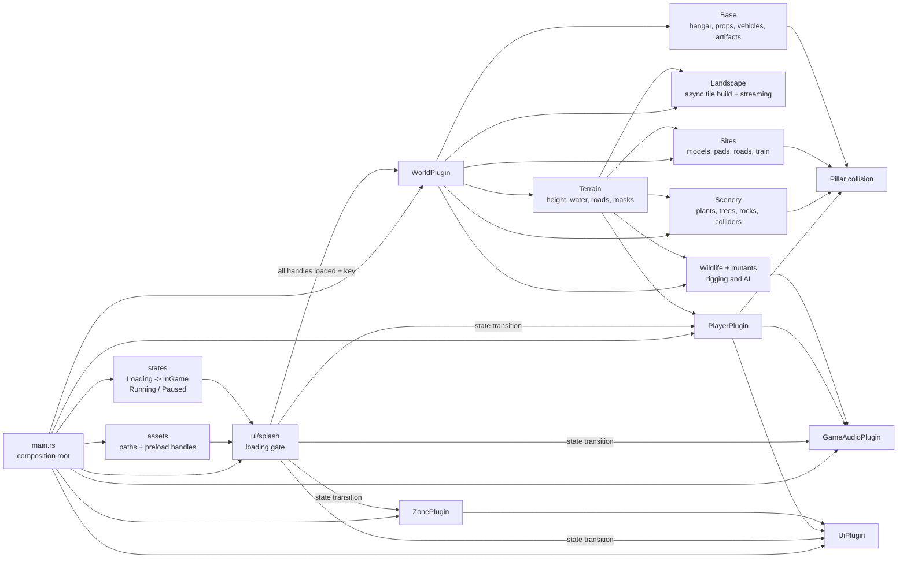

# Roadside-Picnic Architecture Readme

This document is the bird's-eye map of the codebase: what owns what, which
systems run when, how data reaches the player, and where to make a safe change.
For detailed asset recipes and contributor rules, read
[`CLAUDE.md`](./CLAUDE.md) as well.

## Project shape

Roadside-Picnic is a Bevy 0.20 ECS application. The top-level composition root
is [`src/main.rs`](./src/main.rs). It installs Bevy's default plugins, the
state machine, shared asset preloading, and five project plugins:

- `GameAudioPlugin`: synthesized audio, footsteps, engine, mute, and creature cues.
- `WorldPlugin`: terrain, water, roads, scenery, base, sites, wildlife, and lighting.
- `PlayerPlugin`: stalker, animation, camera, input, collision, and armored vehicle.
- `ZonePlugin`: the current run's anomaly and collectible-object loop.
- `UiPlugin`: splash, loading state, HUD, vehicle prompt, pause menu, and FPS.

There is deliberately no separate engine, physics crate, networking layer, or
save system. Most runtime state is local ECS data, and the world is rebuilt
deterministically from fixed seeds and placements.

## Bird's-eye runtime graph



## Module map

| Area | Source | Owns |
|---|---|---|
| Entry point | `src/main.rs` | App composition, global pause and quit |
| States | `src/states.rs` | `AppState::Loading/InGame`, `InGamePhase::Running/Paused` |
| Asset paths | `src/assets/` | Canonical paths, preload handles, shared GLB loader helpers |
| Player | `src/player/` | Stalker, camera, input, gravity, crawling, vehicle interaction |
| Vehicle | `src/player/vehicle.rs`, `vehicle/contact.rs` | Throttle/steer, traction, four-tire terrain fit, wheels, spotlight |
| World | `src/world/mod.rs` | World plugin, terrain/material setup, sky, fog, spawn and teardown |
| Terrain | `src/world/terrain.rs`, `hydrology.rs`, `roads.rs` | Deterministic heights, water, road grading and masks |
| Ground fog | `src/world/ground_fog.rs` | Low 3D density banks, regional visibility, fog camera settings |
| Streaming | `src/world/landscape.rs`, `scenery.rs` | Async terrain build, LOD swaps, 3x3 scenery/collider streaming |
| Site content | `src/world/sites.rs`, `cordon.rs`, `base/` | Landmarks, wall/yard, hangar, props, vehicles, artifact showcase |
| Vegetation | `src/world/trees.rs`, `canopy.rs`, `plants.rs` | Imported and procedural trees, sway, fall, ground cover |
| Wildlife | `src/world/wildlife/` | Shared rigs, gaits, flyers, predator/mutant AI, spatial cues |
| Collision | `src/world/collision.rs`, `world/pillars/` | Static `Pillar` colliders and push-out behavior |
| Audio | `src/audio/` | Synthesized ambience/effects and live audio sinks |
| UI | `src/ui/` | Splash, HUD, FPS, controls, pause |
| Zone loop | `src/zone/` | Current placeholder anomalies, collectible markers, run counters |
| Asset tooling | `tools/` | Texture/GLB preparation, grounding, rigging, collision generation |
| Shaders | `assets/shaders/` | Terrain and water WESL entry points |

## State and lifecycle

### 1. Startup and loading

Startup work is split between `preload_game_assets` and `WorldPlugin`'s startup
systems:

1. `src/assets/mod.rs` puts the critical file and scene handles into
   `PreloadedAssets`.
2. `world/landscape.rs` starts an asynchronous CPU task that builds the distant
   terrain, water, scenery layout, and streamed site data.
3. The world preloads canopies, wildlife primitives, cordon assets, sites, and
   materials.
4. `ui/splash.rs` displays the hangar backdrop and repeatedly checks both the
   direct load state and recursive dependency state of every preload handle.
5. `SplashPhase` becomes `Ready` only after the preload list is complete and
   non-empty. An asset failure moves it to `Failed`.
6. A new key press transitions `AppState::Loading` to `AppState::InGame`.

The preload list is also a contract. If a model is needed during `OnEnter` and
is not preloaded, the splash can report ready before that asset is available.

### 2. Entering the Zone

`OnEnter(AppState::InGame)` runs the world and player spawn paths:

- `WorldPlugin` uploads the completed landscape meshes and spawns terrain,
  water, vegetation batches, sky, sun, ground fog, hangar, props, yard
  vehicles, artifact pedestals, cordon, wildlife, and sites.
- `PlayerPlugin` spawns the stalker and its skinned scene, camera, exposure, and
  atmosphere, volumetric, and distance-fog settings.
- `GameAudioPlugin` starts the Zone ambience.
- `ZonePlugin` spawns its per-run anomaly and collectible placeholders.
- `UiPlugin` creates the HUD.

Most persistent roots are tagged and despawned on leaving `InGame`. Pausing does
not leave `AppState::InGame`; it switches the `InGamePhase` substate, so the
world stays alive.

### 3. Per-frame schedule

```text
PreUpdate
  stream_scenery
  stream_ground_detail
  stream_cordon

Update, only while InGamePhase::Running
  player/camera input
  respawn handling
  vehicle enter/exit
  on-foot motion + collision
  vehicle simulation
  wheel pose + spotlight
  camera follow
  stalker animation
  anomaly checks

PostUpdate, before Transform propagation
  wildlife route/mutant AI
  shared creature rig pose
  artifact idle motion
  tree fall
  canopy motion

Last
  mute processing
  footsteps / door / engine
  spatial creature sounds
```

The transform-changing creature, tree, artifact, and player chains intentionally
run before `TransformSystems::Propagate`. If a new system writes local
transforms after propagation, descendants can appear one frame behind.

Streaming systems run in `PreUpdate` whenever the top-level state is `InGame`,
including while paused. Gameplay and animal motion run only in
`InGamePhase::Running`.

## Terrain, roads, water, and streaming

`Terrain` is the shared source of truth for ground-related systems.

- `height_at(x, z)` samples the analytical terrain plus roads, wetlands, site
  foundations, and the hangar yard.
- `mesh_height_at(point)` follows the rendered triangles, including the 2 m,
  8 m, and horizon interpolation/stitching rules.
- `water_depth_at(x, z)` is used by walking, driving, wildlife validation, and
  scenery rejection.
- `normal_at(x, z)` drives slope checks and grounding.
- `woodland_at` and the site masks decide where vegetation belongs.
- `road_mask` drives terrain exposure, grading, and scenery clearances.

### Tile scales

```text
Playable world:      3,440 m x 3,440 m (half size 1,720 m)
Terrain chunk:       128 m
Nearby sample grid:  2 m
Distant sample grid: 8 m
Horizon chunk:       512 m
Horizon sample grid: 16 m
```

The async landscape build prepares coarse scenic terrain and all site/scenery
layouts up front. Nearby ground tiles swap to their detailed mesh on demand.
Collision, imported trees, and plants stream around the player in a 3x3 tile
neighborhood rather than following the distant visual range.
Bush and weed seeds expand into ten times as many visual plants as dry grass,
with the patch radius widened proportionally. Each shrub/thorn patch root uses
an imported PBR model: a full 4K UHD mesh within 8 m crossfades to a textured
medium variant through the near scenery range; all placements still pass the
road, water, yard, and site-clearance filters before entering a batch.

`RoadNetwork` indexes route segments by terrain tile. It produces both:

1. a smooth graded height surface for walking/driving, and
2. a world-space `Rg8Unorm` texture containing road and tire-rut masks.

Road legs must connect to a real route vertex, stay below the grade and water
thresholds tested in `world/roads.rs`, and avoid cutting through site pads.

## Fog and draw distance

`world/ground_fog.rs` owns the weather layer rather than tying it to the
terrain chunks. On Zone entry it builds a deterministic 128x24x128 periodic
`R8Unorm` density texture and a 4,096 m-wide, 10 m-high `FogVolume`. Layered
horizontal noise shapes the cotton banks, a cloud-dependent vertical envelope
forms their upper billows, and a small texture offset scrolls the banks with
time.

During `InGamePhase::Running`, the volume follows `Terrain::mesh_height_at` at
the player's X/Z position with its center one meter above the rendered ground.
The player camera adds `VolumetricFog` with 48 raymarch steps, while
`VolumetricLight` on the sun supplies directional scattering. The volume stays
above the local ground while its taper preserves the sky and high ridgelines.

`update_distance_fog` derives a regional visibility from the same cloud field
and lowland height. It varies between 1,280 and 2,048 m (10–16 terrain tiles),
and `CAMERA_FAR` caps the perspective camera at 16 tiles. The squared falloff
keeps nearby ground crisp, then rolls distant PBR detail and low cloud banks
into denser fog toward that visibility limit. The terrain extension receives
the current fog ceiling, and `terrain.wesl` applies Bevy's distance-fog result
through a low-ground mask while automatic material fog stays disabled. Bird
bodies and procedural wings also set `fog_enabled = false`. This combination
provides a dense distant shelf without turning the mountain skyline into
full-screen haze. Re-enabling classic fog on `TerrainMaterial` bypasses that
height mask and will wash the ridges.

## Sites, base, and static props

`world/sites.rs` is a registry, not a separate runtime entity per site type.
Each placement references a `Kind`, then shares:

- one prepared GLB,
- one scale and ground datum,
- one entrance axis,
- one pillar-collider slice,
- one road junction,
- one flattened foundation and vegetation/grove mask.

Changing a placement can affect several subsystems at once:

```text
sites::LANDMARKS
  -> RoadNetwork::new
  -> terrain road grading
  -> visual road texture
  -> vegetation masks
  -> rendered model
  -> streamed collision tile
  -> road and placement tests
```

The base is different from the outlying sites. Its root is spawned at
`terrain::BASE`, and the hangar-local furniture uses coordinates relative to
that root. `base/props.rs` owns existing workshop props. `base/artifacts.rs`
owns the fourteen display pedestals, their spotlights, and idle animation.
The static crawler, quarry truck, sedan, and train are in the level rear yard.

The hangar artifacts are display models only. The collectible `Artifact`
component in `src/zone/mod.rs` is a separate gameplay placeholder sphere used by
the current Zone run loop.

## Player, camera, and vehicle

### On-foot code path

`Player` holds movement speeds. `Locomotion` holds live velocity, vertical
velocity, grounded state, and `Gait`. `move_player`:

1. reads camera-relative input,
2. eases planar velocity,
3. resolves pillar collisions with `push_out`,
4. rejects moves into disallowed deep water,
5. samples `Terrain::mesh_height_at`,
6. applies jump/gravity,
7. selects `Idle/Walk/Run/Jump/Prone/Crawl`.

The stalker scene is skinned in `player/animation.rs`. Animation order in the
GLB is an asset contract: the rig script exports the clips sorted as
`Crawl, Idle, Jump, Run, Walk`.

### Armored vehicle code path

`Driving` points from the player entity to the occupied vehicle. Vehicle
simulation is bounded by small substeps even at release speed:

1. ease throttle and steering,
2. sample terrain at four tire points,
3. fit the chassis plane from those contacts,
4. apply limited suspension travel,
5. enforce slope, water, border, and collision constraints,
6. update speed/sliding/fall,
7. roll each accepted wheel distance into wheel animation,
8. copy the vehicle translation to the driver.

Wheel children are discovered from stable GLB node names:

```text
WheelFrontRight
WheelFrontLeft
WheelRearRight
WheelRearLeft
```

Renaming these nodes breaks wheel attachment without changing the Rust types.

## Collision model

Collision is intentionally small and bespoke:

- a `Collider` is a static slice of upright `Pillar` values,
- a `Pillar` has local `x`, `z`, radius, bottom, and top,
- `GlobalTransform` positions/scales the local pillar,
- `push_out` separates a walking body or vehicle swept point from pillar
  cylinders.

Pillars below `STEP_HEIGHT` can be stepped over. A pillar above the body can be
passed under. Crawling uses the smaller prone body.

Generated arrays live under `src/world/pillars/`. Use
`tools/trim_tree_base.py` to regenerate them after a mesh or pivot change:

```bash
blender -b --python-exit-code 1 --python tools/trim_tree_base.py -- \
  assets/models/example.glb - 0 src/world/pillars/example.rs
```

Use `--split-columns` for roofs, tunnels, and open bays where one x/z column
must be represented by multiple separated vertical intervals.

### Collision limitation

The solver assumes upright pillars. Yaw is supported because pillar centers are
transformed, but arbitrary pitch/roll is not mathematically folded into
`bottom`/`top`. A strongly tilted solid should use a conservative upright
footprint or be decorative rather than blocking movement.

## Wildlife and mutants

All animals share the `Kind` registry and the `Rig` builder:

```text
GLB primitive
  -> mesh loaded once
  -> vertices assigned to procedural joints
  -> SkinnedMesh + inverse bindposes
  -> Wildlife motion
  -> pose_wildlife
  -> optional MotionSound
```

Static source meshes do not need baked walk clips. `Rig::build` weights the
vertices against species-specific feet, heads, wings, or grazing heads. The
rig samples the terrain under each foot and keeps the body and head off slopes.

`world/wildlife/mutants.rs` owns the gameplay temperaments:

- bovine: neutral; gives a close player room,
- fleshdeer: curious; turns, approaches, and inspects,
- mutt/chimera: aggressive; notices, chases, braces, lunges, impacts, then recovers.

Mutant patrols are prechecked for dry/flat ground, road clearance, route
separation, and habitat bias. `move_mutants` can send a `Respawn` message after
a valid strike. The sanctuary near the hangar and an occupied vehicle prevent
the hostile loop from targeting the player there.

`LANDMARKS` also seed local wildlife coverage: a deterministic site index
chooses a ground-animal, mutant, or flight route. Ground routes reject the
site pad and road, while birds orbit the site at a terrain-relative altitude.
Every original sky lane is expanded into a five-bird flock with staggered phase,
radius, and altitude; landing ravens keep the original dry perch circuit.
The cross-module test in `wildlife.rs` verifies that every site has a nearby
route rather than relying on accidental grid overlap.

Creature motion also writes `CreatureSound` messages. The audio plugin limits
voices, spatializes world positions, and emits footfall, call, growl, takeoff,
strike, alarm, and impact cues without tying the AI directly to an audio sink.

## UI and player-facing text

All display strings live in `src/ui/text.rs`. Do not put new player-visible
strings directly in systems.

Useful query relationships:

- the HUD reads `ZoneRun`,
- FPS reads Bevy's smoothed frame-time diagnostic,
- the vehicle prompt checks `can_enter_vehicle`,
- controls change with `Driving` and `AudioMode`,
- pause UI follows `InGamePhase`, not the world lifetime.

## Audio

Audio is synthesized in Rust at startup; the game does not depend on audio
files. `Sounds` contains shared ambience, gait steps, jump/landing, vehicle
door, and engine handles.

Important paths:

- footsteps are distance-driven, not keypress-driven,
- teleport distances reset the step clock,
- door sounds follow actual `Driving` transitions,
- engine sound follows occupied vehicle load,
- `M` mutes live `AudioSink`/`SpatialAudioSink` values and pending playback
  settings,
- one-shot sounds are despawned through `DespawnOnExit(AppState::InGame)`.

## Common coupling points and pitfalls

1. **Do not hardcode a ground height.**
   Use `Terrain::height_at` or, when matching visible geometry,
   `Terrain::mesh_height_at`. Grounding from one tile LOD can float on another.

2. **Do not treat `height_at` and `mesh_height_at` as interchangeable.**
   `height_at` is the source sample. `mesh_height_at` matches the rendered
   triangles and is the safer choice for objects, feet, wheels, and pads.

3. **Preload anything required by an `OnEnter` spawn.**
   A missing handle lets the splash look correct until a panic or missing-scene
   observer fires after state transition.

4. **Run the game from the repository root.**
   Use `cargo run` or `cargo run --release`; running `target/...` directly can
   make Bevy resolve its `assets/` root under the executable directory.

5. **One primitive is an explicit contract for helper paths.**
   `assets::load_single_primitive` assumes mesh 0, primitive 0, material 0.
   Use a `WorldAssetRoot` scene for multipart/multimaterial GLBs.

6. **Preserve glTF axes.**
   The game treats glTF `Y` as up. The stalker and many wildlife rigs are
   authored as local `+Z` forward. Measure forward direction in the imported
   GLB; do not infer it from the filename or the artist's Blender camera.

7. **A site move changes the road and terrain.**
   `RoadNetwork` consumes `sites::LANDMARKS` while `Terrain::new` builds. Moving
   a site can create a new grade, water crossing, seam, or vegetation conflict.
   Always run the road-continuity and site-pad tests.

8. **Avoid close or coincident road segments.**
   Crossing routes with different endpoint heights makes the nearest sampled
   leg win abruptly. Prefer a separate turnout/junction before merging back.

9. **Keep placement deterministic.**
   Terrain, trees, patrols, and scattered content use fixed seeds and route
   candidates. Do not use runtime randomness in generation unless the result
   is intentionally per-run.

10. **Collision and visuals must share a pose.**
    Ground a model, generate pillars from the installed runtime GLB, and spawn
    both using the same translation, rotation, and scale.

11. **Do not put solid tilted objects through the pillar solver.**
    A vertical pillar approximation may still be appropriate for a small
    visual tilt, but large roll/pitch values need an alternative collider.

12. **Use roots and child relationships consistently.**
    Add `WorldRoot` to top-level world entities, or use `ChildOf` under a root,
    so exiting the Zone despawns everything. Use `DespawnOnExit` for state-local
    one-shots where appropriate.

13. **Do not use a boolean resource for a top-level game state.**
    Extend the existing Bevy `States`/`SubStates` design. Pause/resume must not
    recreate the Zone.

14. **Transform order matters.**
    If a system changes a parent/child pose, arrange it before
    `TransformSystems::Propagate`. If a system consumes another system's
    component change, use `.chain()` or explicit ordering.

15. **Asset watching is not full hot reload.**
    `bevy/file_watcher` reloads file assets. Procedural terrain, masks, generated
    scenery, synthesized audio, and Rust component changes still need a restart
    or rebuild. Code hotpatching is limited to existing system bodies.

16. **Respect the physical lighting setup.**
    The game camera uses HDR exposure `EV100 13.0`, an atmospheric sun at raw
    sunlight, and no artificial ambient fill outdoors. A material that looks
    correct at default Bevy exposure may be washed out or black here.

17. **Keep fog height-aware.**
    Use `ground_fog.rs` for the low cotton layer. The custom terrain and birds
    intentionally opt out of automatic Bevy distance fog; terrain applies that
    same falloff only through `terrain.wesl`'s height mask, while birds skip it
    entirely. Keep skyline and flyer exceptions in those explicit shader paths.

18. **Be conservative with always-on work.**
    Terrain/scenery are batched and streamed for a reason. Avoid an entity per
    grass blade, rock, tree, or distant plant. Add a `VisibilityRange` and
    streaming owner when the object is not always local.

19. **Keep WASM in mind.**
    New game code should not use `std::thread` or `std::net`; gate unavoidable
    platform behavior. Never enable hotpatching, file watching, or dynamic
    linking by default in release/WASM builds.

## How to add a static site model

Use this path for factories, railway scenes, landmarks, and other fixed props.

1. Inspect the GLB in Blender or from its JSON:
   - one primitive or several?
   - Y-up bounds and forward axis,
   - normals/UVs/tangents,
   - material and image slots,
   - display plaques or detached preview geometry.
2. Simplify if needed, then resize textures. Keep the runtime triangle budget
   intentional.
3. Bake tangents with `--vertex-layout separate`.
4. Ground and normalize the model with:

   ```bash
   python3 tools/prepare_plant_asset.py input.glb \
     assets/models/<category>/<name>.glb
   ```

5. Generate `src/world/pillars/<name>.rs` with `trim_tree_base.py`.
6. Add a canonical path in `src/assets/mod.rs`.
7. Add a model descriptor and placement to `src/world/sites.rs`.
8. Give the site:
   - a road junction,
   - an entrance/front axis,
   - a level-pad radius,
   - a collider slice,
   - a preload entry.
9. Run the site, road, and scenery tests. Inspect the placement in a release
   build from multiple angles.

If the new model is not a site, put its ownership in the nearest plugin rather
than stretching `sites.rs` into a universal object registry.

## How to add a new hangar prop

1. Put the prepared GLB under `assets/models/base/props/`.
2. Add its path to `src/assets/mod.rs` and the global preload list.
3. Add a `Prop` descriptor in `src/world/base/props.rs`.
4. Measure coordinates in the hangar frame:
   - translation relative to `BASE`,
   - yaw,
   - uniform scale,
   - collision pillars.
5. If it needs a light, reuse the prop's `spotlight` pattern.
6. Extend or add a route-clearance test. The north door and diagonal armored
   vehicle route are both invariants.

## How to add an artifact or exhibit

1. Preserve the full source GLB in `assets/models/artifacts/` without
   simplifying its geometry or resizing its texture maps.
2. Add its path to `assets::ARTIFACTS`.
3. Add an `ArtifactModel` descriptor in `world/base/artifacts.rs`:
   - display name,
   - scale,
   - spin/bob/tilt,
   - spotlight palette.
4. Let the showcase assign a pedestal from `TABLE_Z`; do not position the
   artifact directly in world space unless it is outside the hangar display.
5. Ground centered-on-origin sources with
   `python3 tools/ground_full_asset.py <source.glb> <runtime.glb>`. Copy
   already-grounded dense PBR scans without changing their materials.
6. Dense PBR scans may have a distant preview under `artifacts/lod/`, but the
   showcase streams the full source mesh within 8 m and never substitutes the
   preview for the near-view artifact.
7. Keep the model's grounded origin at the tabletop and let `ArtifactIdle`
   animate from a stable `rest` transform.
8. If the artifact is meant to be collectible in the Zone, add gameplay state
   and a `ZonePlugin` entity separately from the hangar exhibit.

## How to add a creature or mutant

1. Add the optimized, grounded GLB and canonical asset path.
2. Add the species to `wildlife::Kind::ALL` and its model/scale/yaw tuple.
3. Add measured foot/head/wing bones to `wildlife/rig.rs`.
4. Confirm the source's +Z-forward orientation and scale in `Kind::model`.
5. Add routes to normal wildlife, `mutants::routes`, or `flight_routes`.
6. For a mutant, select exactly one temperament:
   - `Neutral`,
   - `Curious`,
   - `Aggressive { notice, reach, sprint }`.
7. Keep AI decisions separate from rig/visual posing:
   - activity state changes in `mutants.rs`,
   - movement and gait in `movement.rs`,
   - bone transforms in `rig.rs`,
   - sound events in `mutants.rs`/`sound.rs`.
8. Add pure route checks and a focused encounter test. Do not use runtime
   randomness to make a test pass.

## How to add a terrain feature or road

1. Define the feature in the owning world module, not in the renderer.
2. Add the analytical height/hydrology/mask contribution in
   `terrain.rs`/`hydrology.rs`.
3. If it is a road, add route legs and any site junctions in `roads.rs`.
4. Update vegetation rejection and any material/shader weight.
5. Test the route with three lanes, including:
   - every connected leg,
   - maximum grade,
   - water depth,
   - site entrance,
   - route mask pixels.
6. Test terrain/chunk stitching and a release view at a tile boundary. A road
   that only works at analytic height samples can still crack visually at LOD
   edges.

## How to add a shader or material feature

1. Keep runtime image paths in `src/assets/mod.rs`.
2. Load file shaders through `AssetServer`.
3. Put world-space shader masks on the material resource, not in an entity
   transform that can drift with chunk origin.
4. Preserve sRGB for albedo and linear data for normal/AO/roughness/height maps.
5. Add an asset-preparation tool or script if texture channels are packed.
6. Rebuild/generate mipmaps where the renderer expects sampled data.
7. Validate in release mode; `cargo check` cannot compile a WESL shader at
   runtime or prove a texture channel is correct.

## How to add gameplay events

Use Bevy messages for one-shot communication, matching the existing patterns:

- `Respawn`: sent by anomaly/mutant attacks, read by `PlayerPlugin`.
- `CreatureSound`: written by movement/AI, read by the audio plugin.
- `TreeBreak`: read by tree-fall systems.

Rules:

- a component owns persistent state,
- a message is an event, not storage,
- a resource owns shared state/configuration,
- player-facing text belongs in `ui/text.rs`,
- state transitions belong in the existing `States`/`SubStates`.

## Development workflow

```bash
# Fastest normal iteration
cargo check

# Focused test
cargo test world::base::artifacts
cargo test world::wildlife::mutants
cargo test world::roads

# Full correctness gate
cargo fmt -- --check
cargo test
cargo clippy -- -D warnings

# Real graphics, animation, and framerate validation
cargo run --release
```

GLB validation:

```bash
npx @gltf-transform/cli validate path/to/model.glb
```

Development-only asset watching:

```bash
cargo run --features bevy/file_watcher
```

Fast linking plus watching:

```bash
cargo run --features bevy/dynamic_linking,bevy/file_watcher
```

Code hotpatching is a Dioxus/Subsecond development workflow, not a replacement
for builds:

```bash
dx serve --hotpatch --features bevy/hotpatching
```

It can patch logic inside existing system bodies. New components, resources,
messages, changed system signatures, and newly registered systems require a
normal Rust rebuild.

## Verification checklist

Before declaring a visual or gameplay feature complete:

- `cargo fmt -- --check`
- `cargo test`
- `cargo clippy -- -D warnings`
- `git diff --check`
- validate new GLBs
- verify generated collision from the same runtime GLB
- verify the model is preloaded
- verify the model roots and colliders despawn with their state
- inspect a release run from the repository root
- inspect near and distant views, including a terrain tile boundary if relevant
- verify pause behavior and M mute behavior if the feature affects motion/audio

## Troubleshooting map

| Symptom | First places to inspect |
|---|---|
| Splash stays loading | `PreloadedAssets`, `SplashPhase`, asset log, missing recursive dependency |
| Splash shows failure | first `Could not preload ...` log entry and its exact asset path |
| `Path not found` under `target/release/assets` | launched the binary directly; use `cargo run --release` from the repo root |
| Model is invisible | state spawn schedule, `WorldAssetRoot`, scene label, `VisibilityRange`, missing material |
| Model floats | grounded origin, `datum`, `mesh_height_at`, parent transform, scale |
| Collision does not match mesh | stale `world/pillars/*.rs`, different runtime GLB, mismatched yaw/scale |
| Site appears but terrain tilts through it | `sites::foundation`, pad radius, LOD stitching, road overlap |
| Road has a seam or sudden grade | route intersection, endpoint levels, tile edge, `RoadNetwork::sample`, broad-grade mask |
| Scenery fills a site/yard/road | `clear_footprint`, `reserve_scenery`, `base_mask`, `road_mask` |
| A tree or solid reappears after leaving range | expected if the source tree is reusable; tree-fall state must track "gone" separately |
| Mutant never notices the player | sanctuary/vehicle, dry traversable route, view range, temperament, `target` filtering |
| Mutant looks static | `Mutant` component, `move_mutants`, `Wildlife`, `Rig::build`, `pose_wildlife` schedule |
| Vehicle is stuck at bay | collider route test, wheel/chassis height, site/prop collision, blocked-wheel acceptance |
| Mute does not silence a cue | live sink plus pending `PlaybackSettings`; global volume alone is insufficient |
| Pause still moves content | missing `run_if(in_state(InGamePhase::Running))` on the gameplay system |
| Shader change did not apply | only file-backed assets hot reload; procedural material rebuild may need restart |

## Architecture rules to preserve

- Plugins own their components, resources, messages, and systems.
- Systems are functions, not trait objects.
- Use states for lifecycle/overlay changes.
- Spawn state-owned content in `OnEnter` and clean it in `OnExit`.
- Keep route, height, render, collision, and animation data in the same owning
  domain.
- Prefer precise ECS queries and `ChildOf` relationships over global scans or
  hidden mutable singletons.
- Never make a success-shaped fallback hide an invalid asset, state, or input.
- A visual-only feature still needs an ownership, preload, despawn, and
  performance story.
